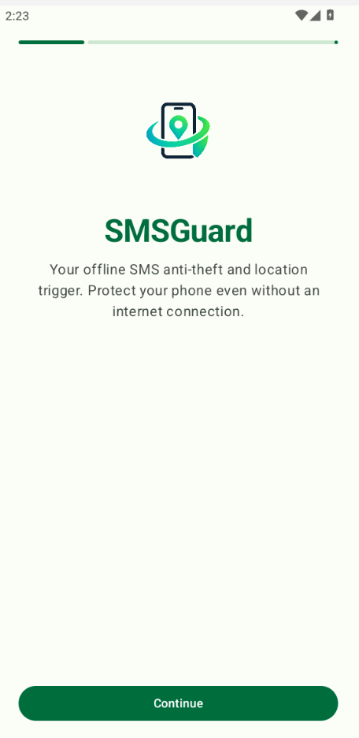
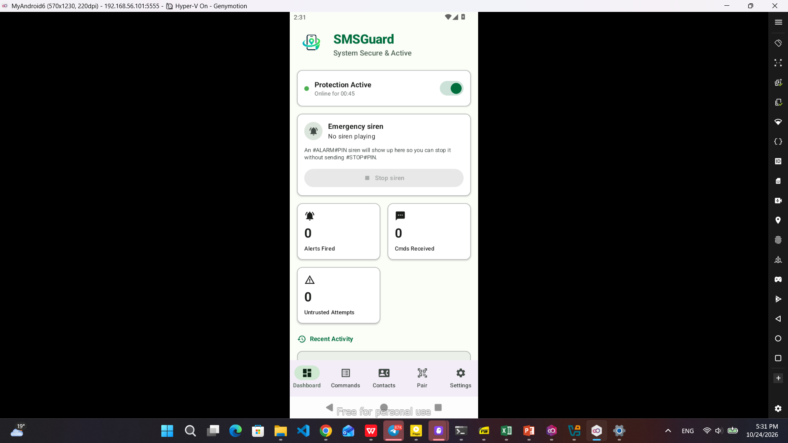
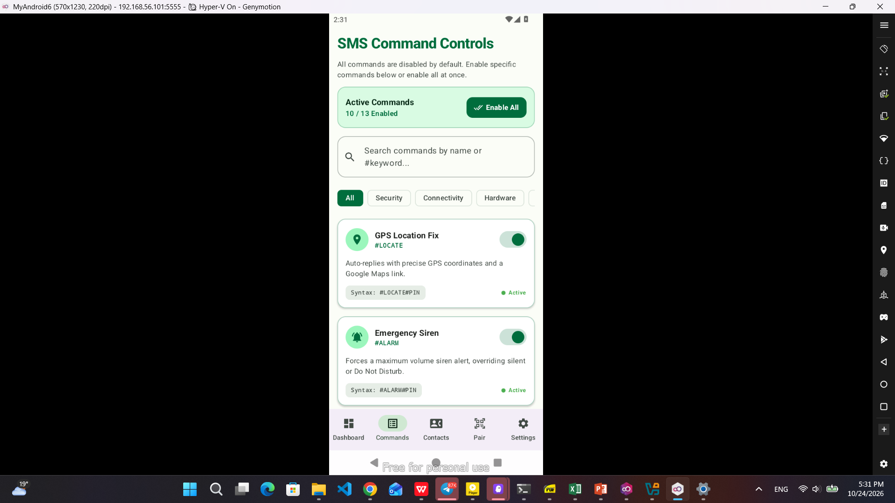
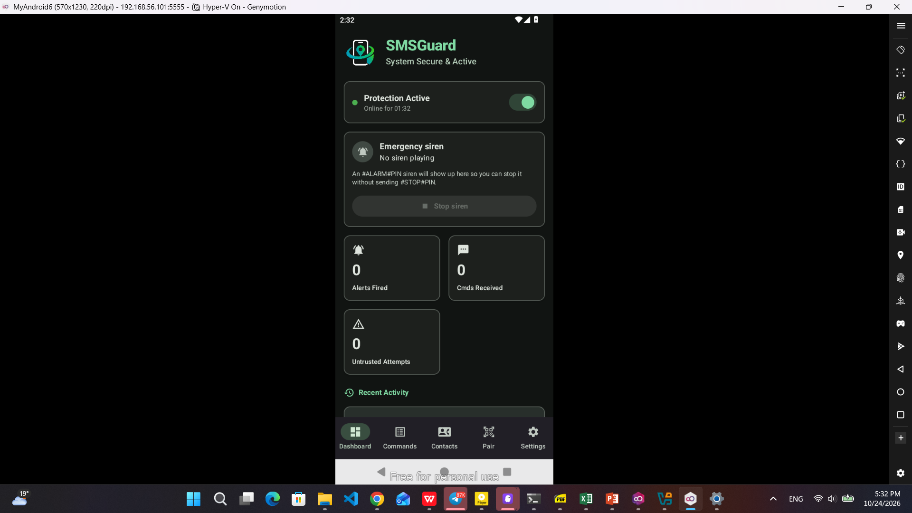
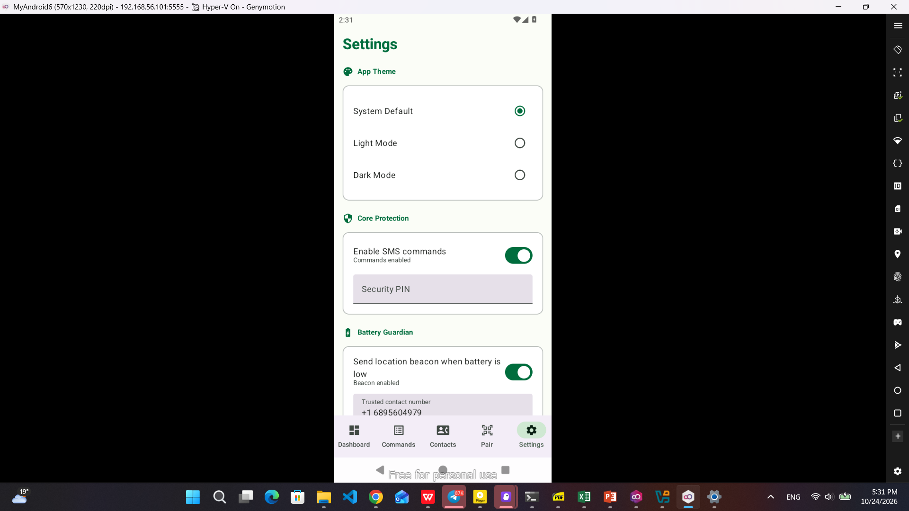

# 🛡️ SMSGuard

### Find, alarm, and lock a lost phone with a single text message.
**No internet. No account. No server. Just a SIM card.**

 

 

&nbsp;

## 👥 The Team
SMSGuard is built by a team of six:
* **Yoftahe Abraham**: CTC-136-26
* **Ephrem Worku**: CTC-4404-26
* **Eyuel Shimeles**: CTC-1312-26
* **Andargachew Getachew**: CTC-396-26
* **Nahom Yemane**: CTC-1782-26

## 📱 The Problem
Phone theft and loss are common, and usual recovery tools depend on conditions a thief can easily break:
* **They need internet:** Cloud "find my device" services only work with mobile data or Wi-Fi. Thieves can turn data off.
* **They need accounts:** Many users never configure them or forget their credentials.
* **They are weak against quick reactions:** Once the phone is switched to silent or offline, the owner has no way to hear it.

SMS, by contrast, works on nearly every network and phone without a data plan, making it a dependable fallback in regions with patchy connectivity.

## 💡 The Solution
The owner installs SMSGuard and sets a secret PIN. If the phone goes missing, the owner sends a command from any phone in the format `#COMMAND#PIN`. The app receives the SMS, verifies the PIN, performs the action, and replies via SMS. No server, account, or internet connection is required.

## 📸 App Screenshots

Here is a glimpse of the SMSGuard interface in action:

| Onboarding & Setup | Main Dashboard (Light) |
| :---: | :---: |
|  |  |

| SMS Command Controls | Main Dashboard (Dark) |
| :---: | :---: |
|  |  |

| App Settings & Security Configuration |
| :---: |
|  |

## ⚙️ How It Works
1. **Setup:** Users grant necessary permissions (SMS, location, phone state, etc.) and set a 4-8 digit security PIN. Devices can also be paired via QR codes and `smsguard://` deep links.
2. **Command Handling:** Incoming SMS messages are checked for the correct format and PIN. Valid commands execute actions (e.g., locating the device, sounding a siren) and reply to the sender.
3. **Low-Battery Beacon:** If enabled, the app monitors battery levels and automatically sends the phone's location to a trusted contact before the phone dies.

## 📜 SMS Command Reference
All commands use the format `#COMMAND#PIN`, where PIN is the owner's security PIN.

| Command | What it does |
| :--- | :--- |
| `#LOCATE#PIN` | Replies with the phone's GPS coordinates and a Google Maps link. |
| `#ALARM#PIN` | Plays a maximum-volume siren, even in silent or Do Not Disturb mode. |
| `#STOP#PIN` | Stops a running siren. |
| `#LOCK#PIN` | Remotely locks the device screen. |
| `#STATUS#PIN` | Full device report: battery, network, Wi-Fi, location, storage, and memory. |
| `#BATTERY#PIN` | Battery percentage, charging state, and device temperature. |
| `#DATA#PIN` | Mobile data connection status and active IP. |
| `#WIFI#PIN` | Wi-Fi status, connected network name, and local address. |
| `#FLASH#PIN` | Flashes the camera LED for 15 seconds to find the phone in the dark. |
| `#INFO#PIN` | Device model, Android version, and system uptime. |
| `#CALLME#PIN` | Triggers an emergency callback alert and notifies the trusted contact. |
| `#CONTACTS#PIN` | Replies with the configured trusted-contact details. |
| `#WIPE#PIN` | Raises an emergency wipe alert and locks the device for safety.* |

*\*Note: `#WIPE` raises an alert and locks the device; it does not erase user data.*
## 🔒 Security Design
* **PIN Authentication:** Every command requires the correct PIN to prevent unauthorized control.
* **Master Switch:** SMS commands can be toggled on or off from inside the app.
* **Siren Override:** The alarm plays at maximum volume even in silent/DND mode.
* **Remote Lock:** Uses an Android accessibility service (explicitly enabled by the user) to lock the screen.
* **SIM Change Detection:** Detects SIM replacement while protection is active (SIM identifiers are never sent via SMS).
* **Least Privilege & Transparency:** A dashboard shows what permissions are granted, denied, or blocked.
* **Offline by Design:** No cloud service means no account database to breach and no data connection to cut.

## 🌐 The Companion Website
A front-end demonstration website supports the app.
* **Home:** Introduces SMSGuard and its features.
* **Lost & Found:** Allows users to report a device as lost using its IMEI and check the status of an IMEI.
* **Dashboard:** Shows counts of registered, lost, and recovered devices.
* **Guide:** Step-by-step instructions for installation and usage.

**Live Demo:** [View the SMSGuard Web Demo](https://smsguard-web.vercel.app/)

## 🛠️ Technology Stack
| Area | Details |
| :--- | :--- |
| **Platform** | Android, written in Kotlin |
| **UI** | Jetpack Compose with Material theming (light/dark mode) |
| **Messaging** | Android SMS APIs |
| **Location** | Device GPS shared as a Google Maps link |
| **Device Control** | Audio override (siren), camera flash, accessibility service (locking) |
| **Build & Versioning** | Gradle, Git, and GitHub with tagged releases |
| **Website** | Next.js + Better-auth and postgres database [link](https://github.com/smsguard-org/smsguard-web)|
## 🧪 Testing
* **Functional Testing:** Conducted on the Android Studio emulator (simulated incoming SMS and mock GPS).
* **Compatibility Testing:** Targeted at Tecno and Samsung phones (widely used locally).
* **UI Checks:** Verified logo and screen rendering in both light and dark themes.

## 🚀 Future Work
* **Replay Protection & Rate Limiting:** One-time tokens and limits on PIN attempts to stop brute-force guessing.
* **Trusted-Number Whitelist:** Only allow approved senders to issue commands.
* **Tamper-Resistant Logging:** Local logs of every command received.
* **Fake Shutdown Screen:** Keeps the phone running and reporting if a thief tries to power it off.
* **Backend Integration:** Connect the website to a real backend with user login to trigger locate requests.

